<!--
Copyright (c) 2026 Omnira CJSC
Author: Tunjay Akbarli
Date: October 14, 2026

Functionality: Codira Programming Language
-->

# Codira Programming Language
### Stable Version: 26.10
### Build: October 14, 2026.

_Codira_ is an ahead-of-time compiled, statically typed language for high
performance systems, built around three ideas: the compiler proves what it
can about your code, a running program can be changed without restarting
it, and one source can target CPUs, GPUs, quantum processors and more.

## Features

- **Proven contracts** - `requires`, `ensures`, loop `invariant`/`decreases`,
  `ghost` state and refinement types are discharged by Z3 at compile time.
  A proven clause costs nothing at run time; a refuted one fails the build
  with a counterexample, which `codira test` can turn into a runnable test.

- **Synthesis** - `??` holes and `choose x where p` are filled only with
  expressions Z3 proves against the contract (`codira synth`).

- **Constant-time code** - `secret` values and `oblivious` functions: the
  compiler rejects any branch, index or loop bound that depends on a secret,
  and `ct_select` compiles to a select, never a branch.

- **Allocation-, panic- and block-free code** - `@noalloc`, `@nopanic`,
  `@noblock` and `@realtime` are proven over the whole call graph; a broken
  promise is reported with the chain of calls behind it.

- **Units of measure** - `f64 unit(m / s)` is checked at compile time and
  erased, so it costs nothing at run time.

- **Algebraic effects and structured concurrency** - `effect`, `perform`,
  `handle`, `resume`; `scope`, `spawn` and bounded channels on a worker pool,
  with every task joined before its scope ends.

- **First class hot reloading** - change code and data layouts of a live
  program. Objects survive layout changes (renamed fields with
  `@renamed(from:)`, retyped fields with defined conversions), and the whole
  GC heap can be saved and restored into another runtime.

- **A verifying optimizer** - Eidos optimizes with equality saturation and
  checks its transformations by translation validation; library authors can
  ship `@rewrite` rules that are proven before they are used.

- **Many targets from one source** - fourteen native targets held to LLVM's
  data layouts, standalone executables (`codira build --exe`), freestanding
  WebAssembly, NVIDIA GPUs (`@target(gpu)`, PTX), quantum kernels
  (`@target(qpu)`, QIR and OpenQASM), inline assembly (`@asm`), and a
  Cranelift backend that runs a program without LLVM or a linker
  (`codira run --jit`).

- **Interop** - C, C++ and assembly sources in a package, with C inlined into
  the Codira that calls it; `codira import-c` reads C headers through Clang;
  `codira bindgen` writes C, Rust, Go and TypeScript bindings; Bun imports a
  `.code` file directly.

- **Bounded execution** - fuel meters native code (`--fuel`), a runtime can
  cap its GC heap, and region arenas have byte quotas.

- **Tooling** - a language server, a build daemon that keeps the compiler
  warm, `codira test`, `codira query` (search by what code returns) and
  `codira quantum`.

What runs end to end today, and what is parsed but not yet compiled, is
listed precisely in [`agents/USING_CODIRA.md`](agents/USING_CODIRA.md)
("End-to-end status today"). Enums, generic instantiation, closures,
`select`, session types, proof-carrying artifacts, zero-knowledge circuits,
Verilog output and experimental hardware memory safety (ARM MTE, a
CHERI-style capability mode) are in progress.

## Compiler architecture

Each stage is a group of crates in `crates/`. Arrows into `codira_smt` (Z3)
and `codira_tv` are proofs the compiler asks for before it trusts a
contract, a transformation or a rewrite rule. The dashed box lists work on
feature branches that has not reached `main` yet.

```mermaid
flowchart TD
    %% ---------------------------------------------------------------- 5
    subgraph TOOLS [" 5. Tooling and interop "]
        direction LR
        CLI["codira CLI<br/>new, build, check, run, start,<br/>test, query, synth, quantum"]
        Daemon["codira_compiler_daemon<br/>warm salsa + LLVM, token-authenticated"]
        LSP["codira_language_server"]
        ImportC["codira import-c<br/>C headers via Clang"]
    end
    TOOLS ==>|drive| FRONTEND

    %% ---------------------------------------------------------------- 1
    subgraph FRONTEND [" 1. Front end: codira_syntax, codira_hir (salsa) "]
        direction TB
        Src["Codira source<br/>*.code, codira.toml"] --> Parse["codira_syntax<br/>lexer, parser, lossless CST<br/>contextual keywords"]
        Parse --> ItemTree["Item tree and name resolution<br/>modules, visibility, imports"]
        ItemTree --> Infer["Type inference<br/>generics, optionals, effects rows"]
        Infer --> Mono["codira_hir::mono<br/>one instance per type argument"]
        Comptime["codira_comptime<br/>compile-time interpreter<br/>fuel + depth limits"] <-->|folds comptime blocks| Infer

        subgraph CHECKS [" Static checks, every one a diagnostic, never a crash "]
            direction LR
            Effects["Effect obligations<br/>uses / handle"]
            Tasks["Structured concurrency<br/>scope, spawn, channels"]
            Flow["Information flow<br/>secret, oblivious, ct_select"]
            Units["Units of measure<br/>f64 unit(m / s)"]
            Realtime["@noalloc @nopanic<br/>@noblock @realtime<br/>call-graph fixpoint,<br/>uses proven divisions"]
            Codegen_ok["Codegen support<br/>honest refusals"]
        end
        Infer --> CHECKS

        subgraph VERIFY [" Contract verification: codira_hir::verify "]
            direction LR
            Contracts["requires / ensures<br/>invariant / decreases / ghost<br/>refinement types"]
            Synth["?? holes and choose x where p"]
            TestGen["Counterexample to test<br/>codira test, codira query"]
        end
        Infer --> VERIFY
    end

    SMT["codira_smt<br/>Z3, deterministic rlimit"]
    VERIFY <==>|bit-vector proof obligations| SMT

    %% ---------------------------------------------------------------- 2
    subgraph EIDOS [" 2. Eidos mid-end: codira_mir, codira_egraph, codira_tv "]
        direction TB
        MirLower["mir_lower<br/>HIR to region SSA"] --> MIR["Eidos MIR<br/>typed region SSA, memory states"]
        MIR --> Passes["MIR passes<br/>const_fold, cse, dce, inline,<br/>unroll, simplify, rewrite"]
        Passes --> EGraph["codira_egraph<br/>equality saturation<br/>hard node cap, exact extractor"]
        Rewrite["@rewrite rules<br/>library equations"] -->|admitted only when proven| EGraph
        EGraph --> Fold["eidos_fold<br/>whole-function constant result"]
        TV["codira_tv<br/>translation validation<br/>counterexamples re-executed"]
        Passes <==>|each transform checked| TV
        Rewrite <==>|proof before use| TV
    end
    Mono ==>|"--mode=release"| MirLower
    TV <==> SMT

    %% ---------------------------------------------------------------- 3
    subgraph BACKENDS [" 3. Back ends: codira_codegen and friends "]
        direction TB
        LLVMGen["codira_codegen<br/>HIR instance to LLVM IR via inkwell<br/>bounds checks, effects, tasks, fuel"]
        Targets["codira_target<br/>14 targets held to LLVM data layouts<br/>--target-cpu"]
        Native["[native] C, C++, asm in a package<br/>bitcode linked before optimization"]
        LLD["codira_lld<br/>in-process LLD"]
        Lib[".codiralib<br/>hot-reloadable shared library"]
        Exe["codira build --exe<br/>standalone executable"]
        Wasm["wasm32-unknown-unknown<br/>module that imports nothing"]
        PTX["@target(gpu)<br/>NVPTX, launched by codira_gpu"]
        CL["codira_cranelift<br/>codira run --jit, no LLVM, no linker"]
        Quantum["codira_quantum<br/>@target(qpu): circuit IR, simulator,<br/>QIR, OpenQASM 2/3"]
        Asm["@asm inline assembly<br/>machine memory intrinsics"]

        LLVMGen --> Targets
        Native --> LLVMGen
        Asm --> LLVMGen
        Targets --> LLD
        LLD --> Lib
        LLD --> Exe
        Targets --> Wasm
        LLVMGen --> PTX
        Bindgen["codira bindgen<br/>C, Rust, Go, TypeScript"]
        Bun["Bun plugin<br/>import a .code file"]
        Lib --> Bindgen
        Lib --> Bun
    end
    Mono ==> LLVMGen
    Fold -.->|constant shortcut| LLVMGen
    Mono ==>|dev JIT| CL
    Infer ==>|"qpu kernels"| Quantum

    %% ---------------------------------------------------------------- 4
    subgraph RUNTIME [" 4. Runtime: codira_runtime, codira_memory, codira_healing "]
        direction TB
        Loader["codira_libloader + codira_abi<br/>type info, GUIDs, dispatch table"]
        Reload["Hot reload<br/>relink dispatch table, migrate heap<br/>@renamed, saturating retypes"]
        GC["codira_memory<br/>mark-sweep GC, size-class blocks<br/>heap cap, heap snapshots"]
        Regions["Region arenas with quotas<br/>W^X OS pages"]
        Pool["Worker pool<br/>scope joins, bounded channels"]
        EffRT["Effect handlers<br/>resume, abort across frames"]
        Fuel["Fuel metering<br/>--fuel"]
        Heracles["codira_healing (HERACLES)<br/>fault interception, @heal strategies"]
        Loader --> Reload
        Reload --> GC
        Fuel --> Heracles
    end
    Lib ==> Loader
    Exe ==> Loader

    %% ---------------------------------------------------------------- in progress
    subgraph NEXT [" In progress on feature branches "]
        direction LR
        N1["enum + match"]
        N2["closures and function values"]
        N3["select, session types"]
        N4["attest: ZK circuits<br/>@target(fpga): Verilog"]
        N5["schedule ... for<br/>LLVM loop metadata"]
        N6["multi-shot continuations<br/>sample / observe"]
        N7["proof-carrying artifacts<br/>codira api-diff"]
        N8["experimental MTE,<br/>software capabilities"]
    end

    classDef frontend fill:#1e293b,stroke:#38bdf8,color:#f8fafc,stroke-width:2px;
    classDef mid fill:#172554,stroke:#60a5fa,color:#f8fafc,stroke-width:2px;
    classDef backend fill:#064e3b,stroke:#34d399,color:#f8fafc,stroke-width:2px;
    classDef runtime fill:#3b0764,stroke:#c084fc,color:#f8fafc,stroke-width:2px;
    classDef tools fill:#422006,stroke:#fbbf24,color:#f8fafc,stroke-width:2px;
    classDef smt fill:#581c87,stroke:#e879f9,color:#f8fafc,stroke-width:2px;
    classDef sub fill:#0f172a,stroke:#94a3b8,color:#f8fafc,stroke-width:1px;
    classDef next fill:#1f2937,stroke:#9ca3af,color:#e5e7eb,stroke-width:1px,stroke-dasharray:5 5;

    class FRONTEND frontend;
    class EIDOS mid;
    class BACKENDS backend;
    class RUNTIME runtime;
    class TOOLS tools;
    class SMT,TV smt;
    class NEXT next;
    class CHECKS,VERIFY sub;

    linkStyle default stroke:#94a3b8,stroke-width:1.5px;
```



## Example

<!-- inline HTML is intentionally used to add the id. This allows retrieval of the HTML -->
<pre language="codira">
<code id="code-sample">// A contract the compiler proves with Z3: no runtime check is emitted.
func clamp(x: i64, lo: i64, hi: i64) -&gt; i64
    requires lo &lt;= hi
    ensures lo &lt;= result &amp;&amp; result &lt;= hi
{
    if x &lt; lo { lo } else if x &gt; hi { hi } else { x }
}

// Units of measure are checked at compile time and erased.
type Speed = f64 unit(m / s);

func speed(d: f64 unit(m), t: f64 unit(s)) -&gt; Speed {
    d / t
}

// Structured concurrency: every spawned task is joined before `scope` ends.
func square(jobs: Channel[i64], results: Channel[i64]) {
    let x = &lt;-jobs
    results &lt;- x * x
}

public func sum_of_squares(n: i64) -&gt; i64 {
    scope {
        let jobs = channel(64)
        let results = channel(64)
        for _ in 0..n { spawn square(jobs, results) }
        for i in 0..n { jobs &lt;- i }
        var sum = 0
        for _ in 0..n { sum += &lt;-results }
        sum
    }
}

// Proven allocation-, panic- and block-free, with bounded loops.
@realtime
func triangle(n: i64) -&gt; i64 {
    var total = 0
    for i in 0..n { total += i }
    total
}

public func main() -&gt; i64 {
    let v = speed(100.0, 8.0)
    clamp(sum_of_squares(10) + triangle(4), 0, 1000)
}</code>
</pre>


## Building from Source

Make sure you have the following dependencies installed on your machine:

* Rust (the version pinned in `rust-toolchain`; `rustup` picks it up
  automatically)
* LLVM 22.1 (a full dev distribution with `llvm-config` and the LLD static
  libraries). Codira reaches it through `llvm-sys` 221, so point
  `LLVM_SYS_221_PREFIX` at its install root, the directory whose `bin` holds
  `llvm-config`:
  * Debian/Ubuntu: `sudo bash scripts/install-llvm.sh` installs LLVM 22 from
    apt.llvm.org; then `export LLVM_SYS_221_PREFIX=/usr/lib/llvm-22`.
  * macOS: `brew install llvm@22`; then
    `export LLVM_SYS_221_PREFIX="$(brew --prefix llvm@22)"`.
  * Windows: extract the LLVM project's
    `clang+llvm-22.1.8-x86_64-pc-windows-msvc.tar.xz` release archive (for
    example to `C:\llvm22`) and set `LLVM_SYS_221_PREFIX` to that directory,
    or build LLVM 22.1 with MLIR and LLD from source with
    `pwsh build-llvm/build.ps1 -InstallDir C:\llvm22\built`.
* Z3 (`libz3` -- used by `codira_smt` for refinement-type checking and
  translation validation). Set `Z3_LIB_DIR` to the directory containing
  `libz3.so` (`libz3.lib` on Windows), or `Z3_ROOT` to a Z3 install prefix.
  On Debian/Ubuntu, `sudo apt install libz3-dev` puts it in the multiarch
  library directory, e.g. `/usr/lib/x86_64-linux-gnu`. On Windows,
  `choco install z3` needs neither variable: Chocolatey's install location is
  searched by default.

Clone the source code:

```bash
git clone https://github.com/theomnira/codira.git
cd codira
```

The doc tests in `crates/codira/tests/book.rs` are generated from the mdbook
in `book/`, which is not part of the repository. Without it the build prints a
warning and skips them.

Use `cargo` to build a release version

```bash
cargo build --release
```

## Language server

Codira contains support for the lsp protocol, start the executable using:

```bash
codira language-server
```

Alternatively, you can install editor-specific extensions.
