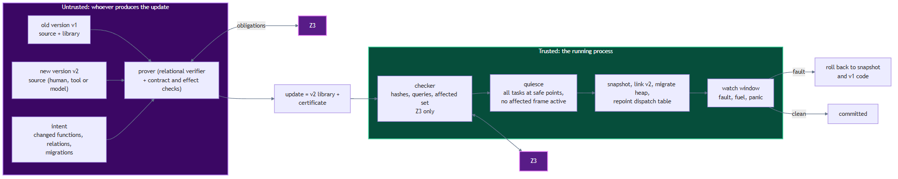
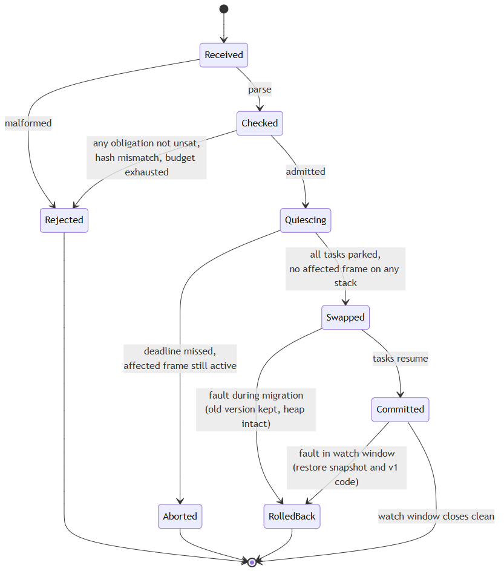

%title: Proof-Gated Live Updates: Admitting a Code Change into a Running Native Program Only With a Certificate It Re-Checks Itself
%author: Tunjay Akbarli (Omnira CJSC) -- author list and affiliations to be confirmed
%date: Draft of 2026-10-15. Results marked TODO have not been measured yet.

# Abstract

Production services are patched under time pressure, and increasingly with changes proposed by automated tools. Dynamic software updating (DSU) lets a running process take a new version without restarting, but the systems that exist either trust the patch or prove only that it is type safe. Offline tools can prove two versions equivalent, but they are not part of the decision a running process makes about whether to accept a change. We present *proof-gated live updates*, implemented in Codira, an ahead-of-time compiled, garbage-collected language whose compiler already proves contracts and effect annotations with an SMT solver. An update is a new version, a declaration of intent, and a certificate. The certificate shows three things: every function the patch did not mean to change still computes the same results and performs the same effects, every changed function still meets its published contract and effect guarantees, and the live heap migrates to the new layouts without losing or reinterpreting data. The running process re-checks the certificate with an SMT solver alone, so it does not have to trust whoever produced the update. It then parks every task at a safe point at which no affected function is active, snapshots the heap, swaps the code through a dispatch table, and restores the snapshot if the new version faults. We describe the definition of a safe update and its soundness argument, a relational verifier that handles straight-line code, calls, loops, memory and effects in increasing levels, and the runtime protocol. {{TODO: evaluation summary, written last: number of updates in the corpus, fraction admitted automatically by level, proof and re-check times, pause times, steady-state overhead, and how many faulty updates were rejected or rolled back and how many were admitted and wrong.}}

# Introduction {#sec-intro}

A service that has to stay up is patched while it runs. The patch is written in a hurry, by someone who did not write the code it touches, and, more and more often, by a tool: a fuzzer-driven repair system or a language model proposes a change to a vulnerability, and an operator has to decide whether to deploy it. Restarting is expensive for stateful services, so dynamic software updating (DSU) systems let the running process take the new version in place [@hicks2001dsu; @neamtiu2006ginseng; @hayden2012kitsune; @arnold2009ksplice; @pina2014rubah]. What those systems check before they apply a change is little. Ginseng and Proteus analyse that an update is type safe and representation consistent [@neamtiu2006ginseng; @stoyle2005proteus]; the first system to make patches verifiable native code did so to establish type safety [@hicks2001dsu]; Linux livepatch checks that no task is inside a function being replaced [@livepatch]. None of them checks that the patched program still *means* what the old one did where the change was not meant to reach, or that it still meets the properties a service promises its callers.

The consequences are concrete. A patch can change the behaviour of a function nobody mentioned, because a shared helper moved. It can weaken a postcondition that callers rely on. It can add an allocation to a path that was promised never to allocate. It can migrate a long-lived data structure through a conversion that silently truncates. And an unchecked hot update applies all of these to a live heap that cannot be rebuilt from scratch.

Verification of such differences exists, but it is run *beside* the update rather than *inside* the decision to apply it. Regression verification proves two versions equivalent [@godlin2013regression]; SymDiff and the merged-program approach of Hayden et al. check differential properties of an update, offline and with user-written specifications [@lahiri2012symdiff; @hayden2012correctness]; VeriBin checks functional equivalence of binary patches before a vendor deploys them [@wu2025veribin]. The running process takes no part: it receives a new library and trusts that someone ran the tool.

**Insight.** Suppose the language has three properties. First, every call between functions already goes through a patchable table, because hot reload needs it, so an update is a small, well-defined edit of one data structure. Second, every heap object carries runtime type information, so a layout change can be migrated mechanically. Third, the compiler already proves, with an SMT solver, the contracts and effect annotations that describe what each function promises. Then the property "this update preserves what it should" can be stated in the language's own terms, proved with the machinery the compiler already has, and handed to the running process as a *certificate*, in the style of proof-carrying code [@necula1996pcc]: the process re-checks the certificate with the solver and nothing else, and decides.

**What we claim.** We do not claim to be the first to verify a software update; {ref:sec-related} lists the closest work and what it does not do. We claim a particular combination, built into the admission path of a running native runtime:

- a definition of a *safe update* that joins behavioural equivalence outside a declared intent, contract and effect preservation, and heap migration, together with an *affected set* of functions that must not be active when the swap happens ({ref:sec-safe});
- a certificate that a process can re-check with an SMT solver alone, and an explicit account of what that does and does not trust ({ref:sec-threat} and {ref:sec-cert});
- a relational verifier, built on the contract verifier of a real compiler, in levels from straight-line integer code to loops, memory and effect traces ({ref:sec-rel});
- a runtime protocol with safe points, a snapshot, migration, a dispatch-table swap and automatic rollback, with a test for each failure mode ({ref:sec-runtime});
- {{TODO: an evaluation on update histories of three services, with fault injection, once the corpus and harness exist (the Evaluation section).}}

**What the certificate does not establish.** It does not show that the *intent* is the right one: if the author declares a function changed and replaces its contract with a weaker one, the certificate faithfully proves the weaker thing. It does not remove the compiler from the trusted base: a certificate is about source semantics and about the bytes of a library by hash, and the compiler that turned source into those bytes is trusted except where translation validation covers a transformation ({ref:sec-threat}). What it removes from the trusted base is the *producer of the update*.

# Background: the parts of Codira an update touches {#sec-bg}

Codira is an ahead-of-time compiled, statically typed, garbage-collected language. We describe only what the rest of the paper uses.

**Dispatch table and hot reload.** A compiled module is a shared library (a `.codiralib`) that exports a small fixed set of entry points. Every call from one Codira function to another is an indirect call through a table of function pointers in the library's data section; none is a direct call to an address. A call therefore depends on the callee's *slot* and signature, not on its address or body. Hot reload links a rebuilt library and repoints the table.

**Typed heap.** Every heap object has a type descriptor with a stable identifier and the offsets of its fields, including which fields hold references. The collector and the migration code use the same descriptors. When a struct's layout changes between versions, migration maps the old object to the new layout by field name, converts retyped numeric fields with defined saturating semantics, and keeps a renamed field's value when the new version marks it with `@renamed(from: "old")`. The whole heap can also be written to a byte stream and restored in a runtime running the same program (a *heap snapshot*), refusing a snapshot whose layouts do not match.

**Contracts, refinement types and effects.** Functions may carry `requires` and `ensures` clauses, loops may carry `invariant` and `decreases`, and types may carry refinement predicates. The compiler proves them statically with an SMT solver using exact bit-vector semantics for each integer width, so a wrapping overflow is visible to the proof, and it reports a counterexample when a proof fails. Functions may be annotated `@noalloc`, `@nopanic`, `@noblock` or `@realtime`; the compiler computes, by a fixed point over the call graph, which effects each function can have, and reports the chain of calls behind a violation. Integer division counts as a possible panic unless the solver proves its divisor non-zero.

**Fault interception.** A separate runtime component (HERACLES) intercepts hardware faults and fuel exhaustion in running Codira code and can run a recovery strategy instead of terminating the process.

**Closures and generics.** Function values are runtime-owned code cells that are repointed on every reload, and each instantiation of a generic function is compiled separately. Both matter for the *affected set* ({ref:sec-safe}), because a closure body and a generic instance are functions in their own right.

# Threat model and trusted base {#sec-threat}

**Who is untrusted.** The producer of the update: a human who made a mistake, a tool that proposes patches, or an attacker who can submit a candidate update to the process. The producer controls the new source, the new library bytes, the intent file and the certificate.

**What the process trusts.**

- The SMT solver (Z3 [@demoura2008z3]) decides each obligation correctly. A solver bug can admit a bad update.
- The *verification-condition generator*: the code that turns source into SMT queries. If it models the language incorrectly, a certificate can prove a statement that is not true of the program. In this work the generator is the same symbolic executor the compiler uses to prove contracts, so a defect there already affects ordinary builds.
- The *compiler's translation of source to machine code*. A certificate is about source semantics; it binds queries to the bytes of the library by cryptographic hash, but it does not prove that those bytes implement the source. Translation validation covers some Eidos optimizer transformations [@pnueli1998tv; @necula2000tv; @lopes2021alive2] and the LLVM back end is trusted. This differs from proof-carrying code [@necula1996pcc], whose goal is to remove the code producer, compiler included, from the trusted base for a *safety policy* checked on machine code. Our goal is narrower: remove the producer of the *update*.
- The hash function that binds queries to code bytes, and the runtime itself.

**What is out of scope.** Whether the declared intent is the right one; stack overflow (no stack bound is computed); calls into foreign C code; shifts by the operand width or more, which are undefined in the compiled code; and an update whose old and new libraries disagree with the compiler version that produced the certificate (the certificate records it, and the checker rejects a mismatch).

# Safe updates {#sec-safe}

We state what the checker establishes. Let a *version* $V = (F, T, C)$ consist of a set of functions $F$ with bodies, a set of types $T$ with layouts, and the contracts and effect annotations $C$ of its functions.

> **Definition 1 (intent).** An intent $I$ for an update from $V$ to $V'$ names a set $\Delta \subseteq F$ of *changed* functions, and for each $f \in \Delta$ one relation: *equal under $\varphi$* (the two bodies agree on every input satisfying the precondition $\varphi$), *refines* (the new body meets the old contract), or *replaces* (the new body meets a new contract $C'_f$ stated in the intent). It also names a set $\Theta \subseteq T$ of *retyped* types, each with a migration $\mu_\tau$: the automatic field mapping or a user-written `migrate` block.

> **Definition 2 (affected set).** The affected set $A(V, V', I)$ is the smallest set of functions of $V$ that contains $\Delta$, contains every function whose body reads or writes an object of a type in $\Theta$ or holds a value of such a type in a local, and contains every function that is, or whose closure bodies and generic instances are, a member of the set above.

> **Definition 3 (safe update).** The update is *safe* when all of the following hold.
> (E) For every $f \in F \setminus \Delta$ present in both versions, $f$ and $f'$ compute the same result, perform the same effect operations in the same order, and leave the same fields and array elements in the same state, given that every callee of $f$ either is unchanged or meets its contract in $V'$.
> (C) For every $f \in \Delta$, the stated relation holds, and the contract of $f'$ is no stronger in its `requires` and no weaker in its `ensures` than that of $f$ unless the intent says *replaces*.
> (F) For every function annotated $\mathsf{@noalloc}$, $\mathsf{@nopanic}$, $\mathsf{@noblock}$ or $\mathsf{@realtime}$ in $V$, the same effect summary excludes those effects in $V'$.
> (M) For every $\tau \in \Theta$, the migration $\mu_\tau$ is total on every value that can occur in a live object of $\tau$, or the values on which it is not total are rejected before the swap.

**The affected set and active frames.** The swap changes code and the layout of heap data at one instant. A task whose stack holds a frame of a function in $A$ would resume on old code against migrated data, or on old code that is no longer the code the table points to, and could read a field at the wrong offset. DSU systems face the same hazard and answer it with explicit update points [@hayden2012kitsune] or a static analysis showing that no active frame is affected [@stoyle2005proteus]. We require:

> **Invariant 1.** At the instant of the swap, no frame of any task belongs to a function in $A$.

The runtime enforces Invariant 1 ({ref:sec-runtime}); the certificate states $A$ and the checker verifies that every function outside $A$ has an obligation of kind (E). A function missing from $A$ that in fact touches a migrated type would make the update unsound, which is why Definition 2 closes $A$ under closures and generic instances and why the prover tests that case ({ref:sec-eval}).

> **Theorem 1 (soundness, conditional).** Assume the solver is sound, the verification-condition generator agrees with the language's semantics, the hash binds the library the process loads, and Invariant 1 holds at the swap. If the checker accepts an update, then (E), (C), (F) and (M) hold of that update, and from the swap on every call to a function in $F \setminus A$ behaves as before, *partially*: wherever both versions terminate.

*Proof sketch.* The checker accepts only when every obligation is unsatisfiable under the recorded resource limit; each obligation is the negation of one conjunct of Definition 3 for one function or type. For (E), take $f \notin \Delta$ and argue by induction on the depth of the call graph below $f$, treating a recursive call as the induction hypothesis, which is the standard rule of regression verification [@godlin2013regression]. At depth zero the obligation compares the two bodies directly. At depth $k$ each callee $g$ is either unchanged, in which case it is the same uninterpreted function on both sides and the induction hypothesis says it computes the same value, or changed, in which case the obligation holds for any function meeting its contract. Termination parity is shown only where both bodies carry a `decreases` clause that the contract verifier proves; otherwise the result is *partial* equivalence. (C) and (F) are the contract implication and effect-summary comparison of {ref:sec-cert}. (M) is the migration totality obligation. Invariant 1 ensures no frame straddles the swap, so the statements about complete calls are the statements about every call after the swap. $\square$

The theorem is a statement about the *checker's acceptance* given the stated assumptions; it is not a verified implementation. {ref:sec-eval} reports how often it is exercised by faulty updates.

**A worked example.** A token-bucket limiter refills its balance by `elapsed * rate`, capped at `cap`.

```codira
public func refill(tokens: i64, elapsed: i64, rate: i64, cap: i64) -> i64
    requires 0 <= tokens && tokens <= cap && 0 <= elapsed && 0 <= rate && 0 < cap
    ensures 0 <= result && result <= cap
{
    let sum = tokens + elapsed * rate;
    if sum > cap { cap } else { sum }
}
```

The compiler's own verifier models wrapping arithmetic exactly, so it refuses this version: when `elapsed * rate` overflows, `sum` can be negative and the postcondition fails. The fix avoids the multiplication when it would exceed the headroom:

```codira
    if rate == 0 { tokens }
    else if elapsed > (cap - tokens) / rate { cap }
    else { tokens + elapsed * rate }
```

Under the precondition that the old body does not overflow, the two versions agree: for `rate > 0`, `elapsed > (cap - tokens) / rate` holds exactly when `elapsed * rate > cap - tokens`, which is the old test. The intent therefore says: `refill` is *equal under* "no overflow in the old body" and *refines* the old contract (the new body also proves the postcondition for all inputs). Consider three candidate patches. A cosmetic change from `>` to `>=` in the old test is admitted, because the two return the same value at equality. A patch that replaces the new test by `elapsed >= (cap - tokens) / rate` is rejected with a counterexample: with `tokens = 0, cap = 5, rate = 2, elapsed = 2`, the old body returns 4 and the patch returns 5. An unchecked hot update would apply that patch to a live limiter. {{NOTE: this example was derived by hand; replace the counterexample with the one the prover prints, and add the corpus identifiers of the three patches.}}

# Certificates and the checker {#sec-cert}

An update certificate is a self-contained list of obligations plus the facts that bind them to the update.

```
certificate := header, affected-set, obligation*
header      := old_hash, new_hash, intent_hash, solver_id, rlimit, compiler_id
obligation  := kind (equivalence | contract | effect | migration),
               subject (function or type symbol),
               query   (SMT-LIB2), expected (unsat)
```

The certificate builds on the one `codira certify` already writes for a single build: SMT-LIB2 queries with the hashes of the code ranges they describe, re-checked without the compiler's front end. An update certificate adds the old-to-new relation, the intent hash and the affected set.

**Checking.** The checker (i) verifies the hashes of the old and new libraries and of the intent; (ii) rejects a solver identifier or compiler identifier it does not accept; (iii) checks that the affected set is closed as in Definition 2 over the call graph recorded in the new library and that every function outside it has an obligation of kind equivalence; (iv) runs every query under the recorded deterministic resource limit and accepts only `unsat`. A query that times out, returns `sat`, returns `unknown`, or fails to parse rejects the update. Nothing is assumed on a timeout.

**Contract and effect obligations.** Contract changes are decided by Z3 as implications between the old and new clauses over the parameters, as in the `codira api-diff` tool: a `requires` that became stronger and an `ensures` that became weaker are breaking unless the intent says *replaces*. Effect obligations compare the effect summaries of {ref:sec-bg} before and after.

**Migration obligations.** For each retyped type the checker compares the layouts, derives the field mapping, and for each retyped field proves that the conversion is total on the values the type's refinement predicate allows, or reports the failing value class.

# Relational verification {#sec-rel}

The checker re-checks obligations; the *prover* produces them. Its core is a relational verifier: given a function $f$ and its new version $f'$, it proves that they agree. We built it on the symbolic executor the compiler uses to prove contracts, because that executor already models integers exactly at every width, handles loops with invariants and measures, and handles `for` loops over ranges and arrays, calls, and contracts. Translation validation of the optimizer (`codira_tv`) covers only loop-free, call-free integer code over unbounded integers, with an explicit overflow caveat, so it is not the foundation here; we use bit-vectors instead.

The prover works in levels. Each level is a usable result, and the evaluation reports, per update, the highest level it needed.

- **L1: straight-line and branching integer code.** Both bodies are executed symbolically from the same fresh inputs, and the prover asks the solver whether the results can differ.
- **L2: calls.** Each callee unchanged by the update is replaced by the *same* uninterpreted function on both sides, so a change to one function is proved in isolation. A changed callee is replaced by its contract in the new version.
- **L3: loops.** Two loops are paired when their structure matches, and the prover proves a coupling invariant inductively. The default invariant is equality of every live variable at the loop head, which is the automatic invariant that makes regression verification work in most practical cases [@godlin2013regression]; user `invariant` clauses are used when given. Loops over ranges and arrays are paired by their bounds. A loop pair the prover cannot couple is reported as unsupported, naming the construct.
- **L4: memory.** Fields and array elements are modelled in the SMT theory of arrays. The intent lists the fields allowed to differ; every other field must be equal in the two final states.
- **L5: effect traces.** The sequence of effect operations (channel sends and receives, allocations, panics) is compared, or the declared difference is.

Anything the levels do not model is `Unsupported`, with a reason, and the update is rejected unless the intent marks the function *replaces* with a new contract that is proved on its own. A function the verifier cannot encode is never silently accepted.

**Related techniques.** The structure follows regression verification [@godlin2013regression] and relational Hoare logic and product programs [@benton2004relational; @barthe2011product], and shares its goal with SymDiff [@lahiri2012symdiff]. The difference is where it runs and what it is for: it is the first half of an admission decision, and its output is re-checkable by a process that has no part of the prover.

# The runtime protocol {#sec-runtime}

{#fig-overview}

An update moves through the states of {ref:fig-states}.

{#fig-states}

1. **Received and Checked.** The process parses the update and runs the checker of {ref:sec-cert}. Failure is Rejected.
2. **Quiescing.** Every task is brought to a *safe point*: the worker pool's tasks, tasks blocked on channels or in a nested scope (a blocked task is parked, which counts), and host threads inside calls into the runtime. The runtime has no stack maps, so collection and snapshotting are only valid while no other thread runs Codira code; safe points exist to guarantee exactly that. Quiescing has a deadline; missing it is Aborted, with no state changed.
3. **The active-frame rule.** Quiescing does not complete while any task has a frame of a function in the affected set on its stack (Invariant 1). A long-running task that stays inside an affected function simply prevents the update until it leaves, and the update is Aborted at the deadline. {{TODO: describe the mechanism the implementation uses to know which functions are active (a per-task shadow stack of function identifiers in builds that ask for updatability, or poll-site information), its cost, and how often realistic updates are blocked by it.}}
4. **Swapped.** The runtime takes a heap snapshot, links the new library, migrates the heap, and repoints the dispatch table. A failure before the table is repointed leaves the old state: linking happens before migration, so a failed link never leaves a migrated heap under old code. A fault during migration restores the snapshot.
5. **Committed and the watch window.** Tasks resume. For a configured window a fault intercepted by the fault-handling component, a fuel exhaustion, or a panic from the new code restores the snapshot and the old code and the program continues on the old version. Old code stays mapped until the window closes.
6. **Serialization.** Updates are serialized; a second update is checked against the result of the first.

{{NOTE: states 2 to 6 describe the protocol as specified in RFC 3; as of this draft the repository has the pieces (dispatch-table relink, a failed link leaving the heap alone, heap snapshots, fault interception) but not the quiescence protocol, the rollback path or the admission gate. the Implementation section records what exists at each commit.}}

**`migrate` blocks.** When a type's layout changes in a way the automatic field mapping cannot express, the author writes a `migrate T v1 -> v2 { ... }` block. The prover treats its result as a value that must satisfy the new type's invariants, and the checker's (M) obligation covers it. {{TODO: syntax, restrictions, and what is proved.}}

# Implementation {#sec-impl}

The system is built inside the Codira compiler and runtime, a Rust workspace. {ref:tab-loc} gives the size of the pieces it builds on at the commit of this draft, counting non-test Rust lines.

Table: Existing components the update system builds on, at commit `5e18c5eae8` (non-test Rust lines). {#tab-loc}

| Component | Role in this work | Lines |
|:--|:--|--:|
| `codira_hir::verify` | contract verifier and symbolic executor | 6,963 |
| `codira_hir::realtime` | effect summaries (`@noalloc` and others) | 1,163 |
| `codira_tv` | translation validation of optimizer rewrites | 1,400 |
| `codira_smt` | Z3 bindings, deterministic resource limit | 1,644 |
| `codira_certificate` | build certificates and their checker | 797 |
| `codira_runtime` | loading, relinking, tasks, host interface | 4,154 |
| `codira_memory` | collector, migration, heap snapshots | 8,537 |
| `codira_healing` | fault interception (HERACLES) | 4,452 |
| `codira_abi` | type descriptors, dispatch table layout | 2,279 |

{ref:tab-status} records, for each part of the design, whether it exists in the repository.

Table: Status of each part of the design at the time of writing. {#tab-status}

| Part | Status |
|:--|:--|
| Dispatch-table relink; a failed link leaves the heap alone | present |
| Field-name heap migration, `@renamed`, saturating retyping | present (commit `d09028e331`) |
| Heap snapshot and restore | present (commit `d09028e331`) |
| Contracts, bit-exact, loops, `for`, `continue` | present (commits `f71a80ef7d`, `1a7eef3a3f`) |
| Effect summaries | present (commit `a5919f822c`) |
| Build certificates and `codira certify`; `codira api-diff` | present (feat/tooling, merged to `main`) |
| Relational prover L1 to L5, update certificate, affected set | {{TODO: status at submission}} |
| Quiescence, `apply_update`, rollback, active-frame rule | {{TODO: status at submission}} |
| `migrate` blocks | {{TODO: status at submission}} |

# Evaluation {#sec-eval}

{{TODO: this whole section is a plan until the harness runs. Nothing below is a measurement.}}

**Questions.**

1. *Coverage.* What fraction of realistic updates is admitted automatically, by prover level? Which are rejected, and are the rejections correct?
2. *Cost.* What are proof time, certificate size and re-check time?
3. *Disruption.* What is the pause at the swap, as a function of heap size and task count, and how does it compare with unverified hot reload?
4. *Steady state.* What does the dispatch-table indirection, plus any safe-point polls, cost compared with plain ahead-of-time calls?
5. *Safety.* Given faulty updates (hand-written, mutation-generated, model-proposed), how many are admitted, rejected, or caught by rollback, and how many are admitted *and wrong*? Zero admitted-and-wrong is the target, and any case is reported.

**Setup.** {{TODO: confirm and fill in.}} All measurements run on one machine: Intel Core i9-14900HX, 32 logical cores, 64 GB RAM, Windows 11 Home, under constant background load from other builds. Because of that load, every timing is reported as a minimum and a median over at least 25 interleaved runs, with the spread, and the load condition is stated.

**Workloads.** Three long-running services written in Codira for this evaluation, driven by a host harness through the runtime's call interface: a key-value store with an open-addressing hash table and a write-ahead log, a ledger and rate limiter with balance invariants stated as contracts, and a stream aggregator with worker tasks and channels. They are small programs written for this study, not production systems. The language has no networking or string library yet, so the workloads use integers, structs, enums, optionals, closures, generics, arrays and channels, and the services are exercised through function calls, not sockets. {{TODO: sizes in lines and functions of each workload.}}

**Update histories.** For each workload an authored history of at least twenty updates, labelled by category and provenance: bug fixes, behaviour-preserving refactors, performance changes, features that change layouts (some with a `migrate` block), seeded regressions that look plausible, contract changes in both directions, and effect changes. {{TODO: the mix actually used, and how each update was derived (adapted from a change pattern in a public project, or invented), because a reader will ask.}}

**Baselines.** (a) Unverified hot reload, the behaviour of the runtime today. (b) Restart and reload from a snapshot. (c) The same prover run offline after the fact, to separate the value of gating at load time from the value of proving at all.

**Fault injection.** A mutation generator over the workload source (flip a comparison, off-by-one in a bound, change a constant, delete a bounds check or a contract clause, swap operands, add an allocation to a hot path, change a field type) produces faulty updates from the real histories. For each we record whether the baseline admits it, the gate rejects it, rollback catches it, or it is admitted and wrong.

Table: Coverage of the prover on the update corpus, by the highest level needed. {#tab-coverage}

| Level | Updates | Admitted | Rejected (correct) | Unsupported |
|:--|--:|--:|--:|--:|
| L1 straight-line | {{TODO}} | {{TODO}} | {{TODO}} | {{TODO}} |
| L2 calls | {{TODO}} | {{TODO}} | {{TODO}} | {{TODO}} |
| L3 loops | {{TODO}} | {{TODO}} | {{TODO}} | {{TODO}} |
| L4 memory | {{TODO}} | {{TODO}} | {{TODO}} | {{TODO}} |
| L5 effects | {{TODO}} | {{TODO}} | {{TODO}} | {{TODO}} |

Table: Cost of admission per update (minimum / median over 25 or more interleaved runs). {#tab-cost}

| Workload | Proof time | Certificate size | Re-check time |
|:--|--:|--:|--:|
| Key-value store | {{TODO}} | {{TODO}} | {{TODO}} |
| Ledger | {{TODO}} | {{TODO}} | {{TODO}} |
| Aggregator | {{TODO}} | {{TODO}} | {{TODO}} |

Table: Pause at the swap by live heap size and task count. {#tab-pause}

| Heap | 1 task | 8 tasks | 64 tasks |
|:--|--:|--:|--:|
| 1 MB | {{TODO}} | {{TODO}} | {{TODO}} |
| 64 MB | {{TODO}} | {{TODO}} | {{TODO}} |
| 1 GB | {{TODO}} | {{TODO}} | {{TODO}} |

Table: Outcomes of fault injection by approach. {#tab-faults}

| Outcome | Unverified reload | Gate only | Gate and rollback |
|:--|--:|--:|--:|
| Rejected before the swap | n/a | {{TODO}} | {{TODO}} |
| Admitted and caught by rollback | n/a | n/a | {{TODO}} |
| Admitted and wrong | {{TODO}} | {{TODO}} | {{TODO}} |

**Threats to validity.** The corpus is authored by us, not collected from deployed systems; the workloads are small; the machine is loaded and a single one; the solver's deterministic resource limit makes results reproducible on one build but they can differ across solver versions; and the semantic gap between source and machine code is closed only where translation validation applies. {{TODO: add whatever the evaluation turns up.}}

# Discussion and limitations {#sec-disc}

**The intent is trusted.** A wrong intent proves the wrong thing. The checker can only refuse changes the intent does not cover; it cannot know what the operator wanted. For automatically proposed patches the intent can be *derived* from the diff, which puts the proposer's own diff in the trusted base, or *written by a person*; the right default for untrusted proposers is the second.

**Partial equivalence.** Without termination measures on both sides, equivalence holds only where both terminate. A patch that turns a terminating function into a looping one is caught only where a `decreases` clause exists.

**Active frames can block an update.** A task that never leaves an affected function prevents the swap. Kitsune's answer is to let the programmer name update points in the main loop [@hayden2012kitsune]; ours is to refuse and abort. {ref:sec-eval} measures how often realistic updates hit this.

**Native code the process cannot see.** An update that changes a foreign C library the program links cannot be proved by this system and is rejected unless the intent declares it trusted.

**Stack overflow and undefined shifts** are outside the guarantees, as in the compiler's other analyses.

**Generality.** The design depends on a dispatch table, runtime type information for every heap object, and a contract and effect language that a solver understands. It is a result about a language designed for it, not a technique for patching arbitrary C programs.

# Related work {#sec-related}

**Dynamic software updating.** Hicks, Moore and Nettles introduced patches that carry both new code and state-transition code, expressed as verifiable native code, to establish type safety [@hicks2001dsu]. Proteus gives a formal calculus with provable type safety and representation consistency, and an updateability analysis that can prove an update independent of the program's state [@stoyle2005proteus]. Ginseng applies this to C with automatically generated patches [@neamtiu2006ginseng], Kitsune updates a whole program at developer-named update points with generated state transformers [@hayden2012kitsune], and Rubah does so for Java on a stock JVM [@pina2014rubah]. Ksplice and Linux livepatch update kernels, with a consistency model that decides when each task may switch [@arnold2009ksplice; @livepatch]. Erlang provides hot code loading as a language feature [@armstrong2003erlang]; a survey covers the field [@survey2022patching]. These systems establish type safety, state consistency or safe switching times. They do not prove that the new version preserves the old version's behaviour where the change was not meant to reach, and none re-checks a proof at load time.

**Verifying updates.** Hayden et al. give the first methodology we know of for automatically verifying the correctness of dynamic updates: a merged program combining old and new versions, user-written client-oriented specifications, and off-the-shelf verifiers, evaluated on updates to Redis and synthetic programs [@hayden2012correctness]. Regression verification proves equivalence of similar programs with callees as uninterpreted functions and automatic loop invariants [@godlin2013regression], and SymDiff checks differential properties [@lahiri2012symdiff]. VeriBin decides at the binary level whether a patch is safe to apply by checking functional equivalence, on 86 samples [@wu2025veribin]. All of these run beside the update. Ours is the same family of reasoning moved into the admission path of a running runtime, with a certificate the process re-checks, and extended with contracts, effect summaries and heap migration as obligations of the same certificate.

**Certificates and load-time checking.** Proof-carrying code ships a proof with native code and lets the consumer validate it [@necula1996pcc]; the eBPF verifier checks untrusted kernel extensions before loading them [@gershuni2019ebpf]. Both verify a unit of code once. We verify a *transition* between two versions of a running program.

**Translation validation.** Pnueli et al. and Necula validate individual compilations rather than the compiler [@pnueli1998tv; @necula2000tv]; Alive2 does so for LLVM IR [@lopes2021alive2]. Our relational verifier solves a different problem, comparing source versions of a function, but uses the same solver-based discipline, and the compiler's translation validation is the part of the trusted base that shrinks as it covers more transformations.

**Automatically proposed patches.** Repair systems and language models propose patches, and recent work asks how to judge them, for example by checking patch equivalence or by machine-checked proofs. {{TODO: do a real literature search of 2023 to 2026 work on checking automatically proposed patches and on verified hot patching, and fix this paragraph; the searches so far found VeriBin and agentic patch-equivalence work but this section has not been surveyed.}}

# Conclusion {#sec-conc}

A running program should not have to take a patch on faith. By making the compiler's proofs about contracts, effects and types the vocabulary of an update, and by making the process the party that re-checks them, a live update can be refused for exactly the reasons a build would be refused. {{TODO: one paragraph of results once the evaluation exists.}} The definition, the checker and the protocol are specified here; the relational prover and the evaluation are the work that decides whether the approach covers realistic updates.

# Artifact and reproducibility {#sec-artifact}

The compiler, runtime, prover, corpus and harness are in one repository, built with a pinned Rust toolchain; the solver is Z3 at the version recorded in every certificate. {{TODO: repository location, commit, build and run instructions, the corpus manifest, and how to reproduce each table.}}
